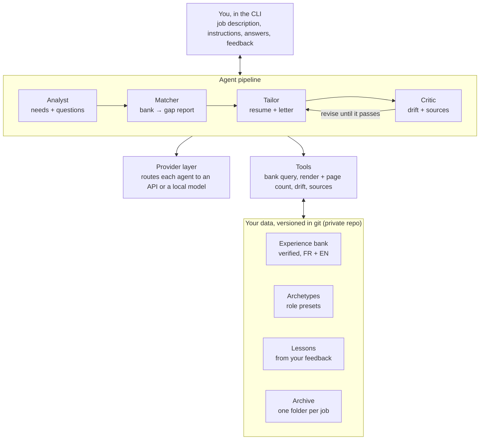
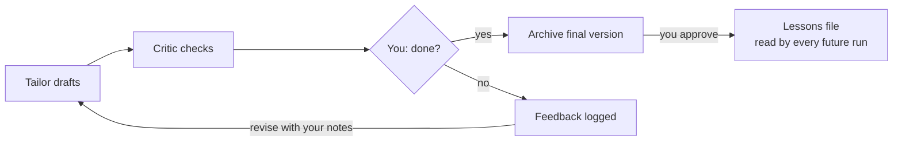

# autoresume: design

Goals, principles, architecture and roadmap. The tasks for each phase are in `docs/plan.md`;
lasting decisions are in `docs/decisions/`.

## Goals

The project has two equal goals: tailor a resume and optional cover letter for each job in minutes,
and learn agentic engineering at the level industry roles expect.

- **Productivity:** paste a job description, answer a few questions, revise with the agent until I
  say done, and get a one-page PDF (plus an optional letter) in French or English, archived automatically.
- **Learning:** build the agent stack from scratch: tool loop, provider abstraction, structured
  outputs, multi-agent orchestration, human-in-the-loop state, evals, tracing, cost tracking, MCP.
- **Portfolio:** a public repo with personal data kept out, which becomes an entry in the projects
  section of the resume it produces.
- **Budget:** a few dollars per application at most, using the cheapest model that does each step well.

## Design principles

The core rule is selection over generation: the agent chooses and orders content I have verified,
and never invents a claim.

1. **The experience bank is the source of truth.** Every bullet, skill and project lives in one
   master file I wrote and checked. The agent selects, orders and lightly rephrases; a new claim
   enters the bank only after I approve it.
2. **Archetypes first, small deltas second.** A few presets (research engineer, embedded AI, audio
   DSP, later agentic) fix the profile summary, skills order and default bullet variants. Each job
   only adds small changes on top. When no archetype fits, the analyst says so and drafts a new one
   for my approval.
3. **A drift budget keeps the resume generic-looking.** Measurable limits: maximum bullets swapped
   versus the archetype, maximum verbatim phrases from the job description, and a ceiling on
   resume-to-JD similarity.
4. **Every claim is traceable.** Each sentence in the resume and the cover letter maps back to a
   bank entry. The critic checks this mechanically, which matters most for the more generative
   cover letter.
5. **I decide when it is done.** The agent revises with my feedback until I approve, and approved
   lessons carry over to future applications.
6. **Content is data.** YAML content, a Typst template and git history make every version diffable
   and reproducible.

## Architecture

Four agents run in sequence, call shared tools and models, and read and write only my versioned data.



The critic loops the tailor until drift and traceability checks pass, before anything reaches me.

- **Analyst:** turns the job description into must-haves, nice-to-haves, seniority and tone, picks
  the closest archetype or flags that none fits, and asks me its questions.
- **Matcher:** maps each requirement to bank entries and reports gaps I cannot honestly cover.
- **Tailor:** applies the archetype plus small deltas to the resume, and drafts the cover letter
  from my past letters' style.
- **Critic:** reads as a skeptical recruiter: overfitting, unsupported claims, ATS problems, tone.
- **Tools:** query the bank, render with Typst and count pages, measure drift, and check that every
  claim has a source.
- **Provider layer:** sends each agent to its configured model, cheap or local for parsing,
  stronger for writing and critique.

### Archetype learning

I confirm or correct every archetype pick. Each decision (job summary, agent's guess, my verdict)
is logged. For a new job, the most similar past jobs are retrieved by embedding distance and added
as examples to the classification prompt. Track the agreement rate; once it stays high, ask only
when confidence is low. Repeated overrides of one archetype trigger a proposal to reword its
description. Guard against proliferation: before creating a new archetype, show the nearest
existing one and offer a variant (variants can inherit from a parent).

## Feedback loop

Each application is a revision loop that ends only when I say done; my feedback is logged and can
become a lasting lesson.



The critic re-checks every revision, so my feedback can reshape the text but never slip in an
unsupported claim.

- **Within an application:** after each draft I give free-form notes ("too salesy", "mention the
  patent", "cut the letter's second paragraph"). Each new draft comes with a diff against the
  previous one.
- **Feedback log:** every round stores the draft version, my notes and the change made, in the
  application folder. Sessions are resumable.
- **Across applications:** when I say done, the agent proposes up to three lessons from the
  session. I approve or edit each one before it reaches the lessons file.
- **Built-in metric:** feedback rounds per application should fall over time.
- **Archetype drafts:** when the agent drafts an archetype and I refine it, both versions are kept;
  the diff is my positioning judgment and can become lessons.

## Phases

Eight phases, each ending with something usable. A phase's tasks are added to `docs/plan.md`
with `/jam` just before it starts, from this table, the decision records, the code as it is then,
and the previous phase's retro.

| Phase | Deliverable | Learning goal |
| --- | --- | --- |
| 0. Foundation (no LLM) | Pydantic bank schema, bank filled in FR and EN, Typst template, `render` command, a new one-page resume designed from scratch; 3–4 seed archetypes drafted then refined by me | Data modeling, validation, Typst, project tooling (uv, ruff, pytest, CI) |
| 1. Single structured call | Job description in, tailoring decisions as JSON out, rendered PDF; one provider. Plus an `add-experience` command that interviews me and saves a validated bank entry | Prompting, structured outputs, schema validation and retries, conversational data capture |
| 2. Agent loop | Hand-written tool loop with bank query, render, page count and drift check; automatic one-page fitting | Tool calling, message history, stopping conditions, error handling |
| 3. Feedback loop + cover letter | Revise-until-done loop, diffs between drafts, feedback log, lessons file; letters using my past ones as style examples | Human-in-the-loop, persistent and resumable state, long-term memory, few-shot style |
| 4. Provider layer | Anthropic and OpenAI-compatible adapters, per-step routing, a local model through Ollama | API abstraction, tool-format differences, cost and quality trade-offs |
| 5. Multi-agent | Analyst, matcher, tailor and critic with checkpoints, traceability check, archetype detection and learning | Orchestration, handoffs, critic loops, retrieval of past decisions |
| 6. Quality | Eval set from past and hand-picked job descriptions (pasted in), metrics (drift, traceability, page fit, feedback rounds, archetype agreement), tracing, cost per run | Evals, observability, prompt regression testing |
| 7. Extras | MCP server over the bank; gap interviews that add verified bullets | MCP, tool servers, agent-driven knowledge capture |

Phase 0 deserves real time: the agents can only be as good as the bank they select from.

Candidate seed archetypes: audio ML research engineer, embedded/edge audio AI, real-time audio DSP
and MIR, speech AI. Agentic AI later, once projects back it.

## Tech stack and repo

Plain Python with no agent framework, so every layer is mine to write and explain.

| Concern | Choice | Why |
| --- | --- | --- |
| Tooling | Python, uv, ruff, pytest, pre-commit, GitHub Actions | Standard team practice |
| Content | YAML validated by Pydantic | Readable, diffable, strict schema |
| Rendering | Typst through its Python package | Fast compile, reads data natively, page count is checkable |
| LLM access | Own adapters: Anthropic SDK + OpenAI-compatible client (also covers Ollama) | Learn how providers differ; compare with LiteLLM later |
| CLI | Typer | Simple commands and interactive prompts |
| Tracing | JSONL logs per run first, Langfuse optional later | See every call, token and cost |
| Storage | Files in git | No database needed at this scale |

The code repo is public on GitHub; personal data lives in a separate private repo:

```text
autoresume/                   # public code
  src/autoresume/
    bank/        # schema, loading, queries
    render/      # Typst templates, render, page check
    llm/         # provider adapters, routing
    agents/      # analyst, matcher, tailor, critic, loop
    feedback/    # feedback log, lessons, archetype decisions
    cli.py
  tests/
    fixtures/    # fake data only
  evals/
  examples/      # fake bank and archetype for demos
  docs/

autoresume-data/              # private
  bank.yaml
  archetypes/
  letter_examples/
  lessons.md
  archetype_decisions.jsonl
  eval_jds/
  applications/
    2026-10-12_company_role/
      job_description.md
      instructions.md
      session.jsonl
      resume.yaml   resume.pdf
      cover_letter.md   cover_letter.pdf
      feedback.md
```

## Risks

The biggest risk is effort, not technology: phase 0 can stall if the bank feels like homework.

- **Bank effort:** start with current experiences only; add variants as applications reveal gaps.
- **Local models:** tool calling around 7B parameters is unreliable; keep them on simple steps.
- **Lesson creep:** each lesson needs my approval, and the file gets a periodic review.
- **Privacy:** check each provider's data-retention terms before routing personal data to it.
- **Small sample size:** callbacks are too rare to measure quality; rely on proxy metrics and judgment.
